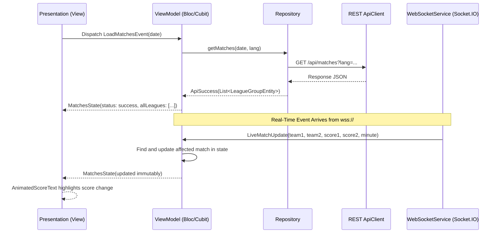

# 154Score - Architecture Documentation

## Overview
**154Score** is built with **Flutter** using strict **Model-View-ViewModel (MVVM) and Clean Architecture principles**, structured feature-first for scalability, testability, and 60/120 FPS rendering performance.

---

## Architectural Layers

```text
lib/
├── app/
│   ├── app.dart                   # MaterialApp.router, multi-bloc provider, theme & localization
│   ├── navigation/
│   │   └── app_scaffold.dart      # Responsive shell (Mobile bottom bar, Tablet rail, Desktop sidebar)
│   └── router/
│       └── app_router.dart        # GoRouter deep-link routes (/matches, /match/:id, /standings, etc.)
│
├── core/
│   ├── constants/                 # ApiEndpoints, AppColors, AppTypography, AppDimensions
│   ├── di/                        # GetIt injection container
│   ├── errors/                    # Failures and Exceptions
│   ├── localization/              # Arabic (RTL) & English (LTR) Localizations
│   ├── network/                   # Dio ApiClient, ApiResult<T>, NetworkInfo
│   ├── storage/                   # LocalStorageService (SharedPreferences)
│   ├── theme/                     # Material 3 Light & Dark AppTheme
│   ├── utils/                     # DateFormatter, ScoreHelper
│   ├── websocket/                 # Socket.IO WebSocketService & LiveMatchUpdate
│   └── widgets/                   # Reusable AppImage, SkeletonLoader, LivePulseBadge, ErrorView, EmptyView
│
└── features/
    ├── home/                      # Dashboard, live matches carousel, popular competitions, highlights
    ├── matches/                   # Dedicated matches center, date strip, filters, real-time match cards
    ├── match_details/             # Match center: Overview, Events timeline, Stats comparison, Info, News
    ├── standings/                 # League tables with UCL/UEL/Relegation indicators
    ├── transfers/                 # Transfer market cards, price badges, club transfers
    ├── videos/                    # Video feed, championship categories, video detail viewer
    ├── profiles/                  # Stadium, Referee, and Commentator profile centers
    ├── favorites/                 # Local favorites management
    ├── settings/                  # Appearance, Language, Time format, Timezone, Diagnostics
    └── search/                    # Global fuzzy search for teams, competitions, and matches
```

---

## Data Flow & WebSocket Reactive Synchronization



---

## Key Principles Followed
1. **Zero UI Imports in Business Logic**: ViewModels / Blocs never import `package:flutter/material.dart` or consume `BuildContext`.
2. **Immutability**: All states, entities, and DTOs use `Equatable` or immutable structures with `copyWith`.
3. **No 3rd-Party Football APIs**: Strictly powered by `154score API` and `Socket.IO WebSocket`.
4. **Local Persistence**: No Firebase / Supabase. Fast device persistence via `shared_preferences`.
